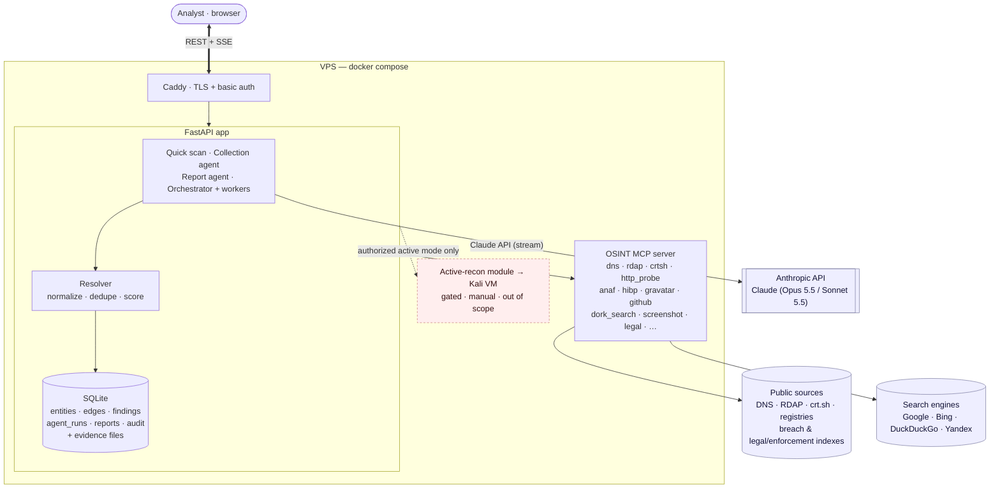
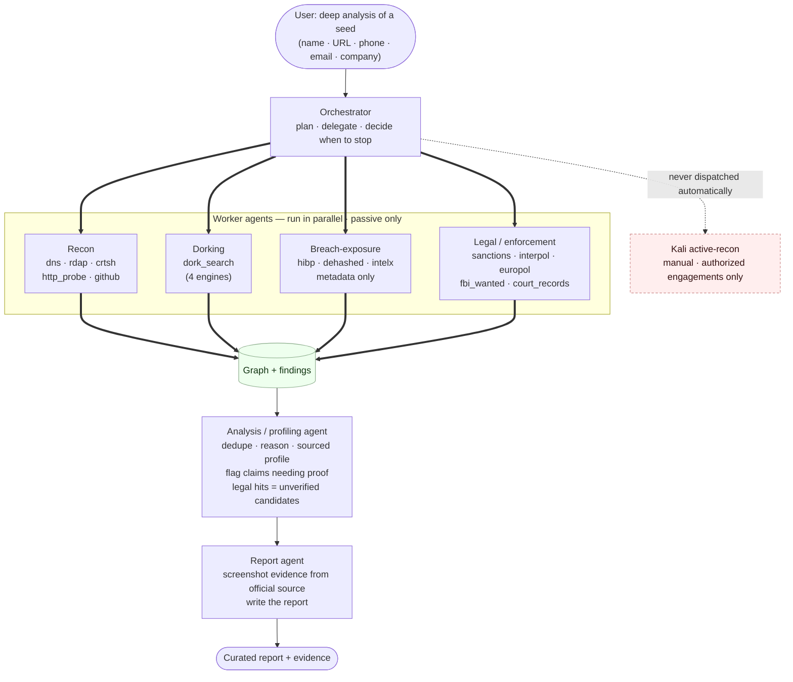

# 2. Architecture

Demo-scale: one VPS, 2–3 concurrent users. No queues, no separate workers, no
graph database. Collection runs as async tasks inside the API process.

## High-level

Everything runs on one VPS, deployed with a single `docker-compose.yml`
(`caddy`, `app`, `mcp`). The app talks to the Claude API for the agents, and to
the outside world only through the MCP server's tools.



## Ways to run an investigation

### 1. Quick scan (deterministic, no LLM)

The user enters a target, the backend detects its type and runs every matching
connector in parallel with `asyncio.gather`, then pivots once on the new
entities (depth 1–2). It's fast, cheap, and predictable. This is the fallback
if the Claude API is slow or unavailable during the demo.

### 2. Collection agent (Claude)

The user enters a target plus an optional goal ("map the attack surface",
"who runs this company?"). Claude gets the OSINT tools from the MCP server and
decides which to call, reads the results, chooses what to pivot on, and stops
when it has enough.

The backend runs the agent loop itself (see below), so every tool call and
result passes through our code. That lets us:

- store each tool result as a **finding** (provenance) and extract entities
  into the graph;
- stream progress to the UI over SSE ("calling crtsh on example.com...");
- enforce limits: max tool calls per run, passive-only tools unless the
  investigation is in active mode, per-source rate limits.

The collection agent's job ends at a full, raw graph. It does **not** write the
report — that's deliberately a separate step, because "gather everything" and
"decide what's worth reporting" are different skills and a single agent tends
to do both badly.

### 3. Report agent (reasoning + evidence)

A second agent takes the assembled graph and findings and produces the report.
Its job is judgment, not collection: decide what actually matters, drop the
noise, and back up each kept claim with evidence.

What it does:

- **De-duplicate and consolidate.** The resolver already merges on exact keys;
  the report agent catches the rest — the same fact stated three ways, two
  articles about one event, a person and their obvious alias — and collapses
  them into one reported item.
- **Filter for relevance.** Findings that don't serve the investigation's goal
  are left out of the report (they stay in the graph as evidence, just not in
  the write-up). This is where a raw 200-node graph becomes a readable report.
- **Capture evidence.** For each item it keeps, it calls the `screenshot` tool
  on the supporting URL so the report carries a rendered snapshot of the page,
  not just a link that may rot. The screenshot is stored as a `Document`
  finding linked to the entity.
- **Write it up.** Structured sections (infrastructure, company, people,
  web mentions) with findings, confidence, and a citation to the source
  finding behind each one.

It reads the graph through a few read-only tools (`get_entity`,
`get_findings`, `list_highlights`) plus `screenshot`; it has **no** collection
tools, so it can't go pull new data — it can only reason over what's there and
capture evidence for it. The analyst reviews its draft before export.

### `screenshot` tool

Headless Chromium (Playwright) renders a URL to a PNG, which is saved to disk
and recorded as a `Document` finding (URL, captured_at, sha256, image path).
Used by the report agent for evidence, and available in the graph UI as a
"capture evidence" button on any `URL` node.

Note it **fetches the page**, so like `http_probe` it's active toward whatever
host serves that URL. For the screenshots the report agent takes — news
articles, public profiles, search hits — that host is a third-party site, not
the target's infrastructure. Capturing the target's own site stays under the
same active-mode rules as `http_probe`.

### 4. Deep analysis (orchestrated multi-agent)

The user asks for a deep analysis and gives minimal seed info — a name, URL,
phone, email, or company. An **orchestrator** agent plans the investigation and
delegates to specialized worker agents, each with a narrow toolset. Workers run
in parallel where they're independent; the orchestrator collects their results,
decides whether to dig further, and hands everything to the analysis and report
agents at the end.



**Orchestrator.** A Claude loop whose "tools" are *dispatch a worker* calls.
It turns the seed into a plan ("resolve the domain, enumerate web presence,
check breach exposure, gather public mentions"), fans the independent tasks out
to run concurrently, reads the summaries each worker returns, and loops once or
twice if a result opens a new thread (a new domain, a company behind an email).
It owns the stopping condition and the per-run budget.

**Worker agents** — each is a small agent with only the tools for its job:

| Worker | Tools | Produces |
| --- | --- | --- |
| Recon | `dns`, `rdap`, `crtsh`, `http_probe`, `github` | infrastructure, subdomains, tech, emails |
| Dorking | `dork_search` (Google/Bing/DuckDuckGo/Yandex) | where the target is named/mentioned |
| Breach-exposure | `hibp`, `dehashed`, `intelx` (passive indexes) | which breaches an email/phone/username appears in — **metadata only, never plaintext passwords** |
| Legal / enforcement | `sanctions`, `interpol`, `europol`, `fbi_wanted`, `natl_wanted`, `court_records` | sanctions / PEP / wanted-notice / court hits — as **unverified candidates** pending disambiguation |

(The diagram above shows three workers for space; the legal/enforcement worker
runs alongside them.)

**Analysis / profiling agent.** Reads the whole graph — especially the dork
hits and the pages behind them — and reasons over it to build an understanding
of the target: who/what it is, its online footprint, affiliations,
public activity and interests, and related entities (for a company: officers,
domains; for a person: public profiles and clearly-associated people). It
consolidates duplicates, resolves which hits are actually the same target, and
writes each attribute as a **fact tied to the source finding that supports it**
— not a guess.

Because profiling a person touches sensitive data, this agent follows the rules
already in [Legal & Ethics](06-legal-ethics.md):

- It stays within the investigation's stated **purpose**; attributes that don't
  serve it are left out.
- **Special-category data** (political opinions, religion, health, sexual
  orientation — GDPR Art. 9) is only reported when it's directly relevant to a
  lawful purpose, is **flagged** as sensitive, and is stated as a sourced fact,
  never as an inferred leaning. The agent does not speculate about someone's
  politics or beliefs from circumstantial signals.
- Private-individual and **minor** guardrails apply: the profiling of a person
  who appears to be a minor is blocked, as elsewhere in the platform.
- **Legal/enforcement hits are candidates, not verdicts.** A sanctions, wanted,
  or court match is reported only as a *possible* match until a disambiguator
  (date of birth, nationality, photo, ID) corroborates it; the agent never
  states that a person is wanted or sanctioned off a name match alone. See the
  name-collision warning in [Sources](04-sources.md#legal--law-enforcement).

It ends by marking the claims that should carry proof — including any legal or
enforcement listing — which the report agent then screenshots from the official
source.

**Active tooling is not in this workflow.** The orchestrator dispatches only
passive workers. Anything requiring the Kali VM stays in the manual,
authorization-gated active-recon module below — the orchestrator never calls
it.

**Models (cost).** Orchestrator and analysis/profiling agent on
`claude-opus-5-5` (the judgment-heavy roles); the high-volume workers (dorking,
breach lookups, recon) can run on `claude-sonnet-5-5` to keep a deep run
affordable. For the demo, a single deep analysis is a handful of worker runs,
so this stays well within budget.

> **Status: built.** `POST /investigations/{id}/deep`. Workers: infrastructure,
> web_presence, people_identity, company_registry, breach_exposure,
> legal_screening (`app/agent/tools.py` `WORKERS`), each limited to its own
> tools, sharing one lookup budget; the orchestrator runs on
> `OSINT_AGENT_MODEL` (Opus 5.5), workers on `OSINT_WORKER_MODEL` (Sonnet 5.5),
> and the report agent runs automatically at the end. Live test on emag.ro:
> 4 parallel workers + 1 follow-up, 27 lookups, report in 214 s.
>
> **Build note.** This is the ambitious mode. For the hackathon, build modes 1–3
> first; the orchestrator is a natural extension once the worker agents and the
> MCP tools exist, since each worker is just the collection agent with a
> restricted toolset and a focused prompt.

## Claude integration

| Setting | Value |
| --- | --- |
| Model | `claude-opus-5-5` for both agents |
| Thinking | collection `effort: "medium"`; report `effort: "high"` (the reasoning step is where judgment matters) |
| Streaming | `client.messages.stream(...)`, forwarded to the browser as SSE |
| Tools | listed from the MCP server at startup; collection agent gets the OSINT tools, report agent gets the read-only + `screenshot` tools |
| Loop | manual loop or SDK tool runner; parallel tool calls run concurrently |
| Budget | cap on tool calls per run (e.g. 40) and `max_tokens` |

Things to handle:

- **`stop_reason: "refusal"`**: safety classifiers can decline requests that
  look like targeting a private person. Check `stop_reason` before reading the
  output, show a clear message in the UI, and keep the Quick scan path
  available. A clear purpose in the system prompt (authorized security
  assessment / due diligence) helps.
- **Prompt injection**: tool results contain text from untrusted web pages.
  The system prompt tells Claude that tool output is data, never
  instructions, and the tool layer never performs actions beyond lookups.

### Why the backend runs the loop (client-side MCP)

| Option | How it works | Verdict |
| --- | --- | --- |
| **Backend as MCP client** | FastAPI connects to the MCP server, lists its tools, and executes Claude's tool calls through it | **Use this.** Every result is captured for the graph and the UI. The MCP server can stay private on the VPS. |
| API MCP connector | Anthropic's API calls the MCP server directly over a public URL | Less code, but results bypass our backend, so building the graph is harder. Also requires exposing the MCP server publicly with auth. |

### Bonus: the MCP server works outside the app

Because the connectors are an MCP server, analysts can also plug it into
Claude Desktop or Claude Code and investigate conversationally. That's a good
extra demo moment and costs nothing extra to build.

## OSINT MCP server

- Python, built on the official MCP SDK (`FastMCP`), streamable HTTP transport.
- Each tool is a thin wrapper around a connector function. The same functions
  are imported directly by the Quick scan path, so there's one
  implementation per source.
- Tools return structured JSON: `{source, fetched_at, raw, entities[], relationships[]}`.
- Each tool declares `passive: true/false`. The agent only gets active tools
  when the investigation allows them.
- Simple in-memory TTL cache and per-source rate limiting inside the server.
- API keys (HIBP, Shodan, GitHub, ...) come from environment variables.

### Connector contract

```python
@dataclass
class ConnectorResult:
    source: str
    fetched_at: datetime
    raw: dict                       # stored unchanged as evidence
    entities: list[EntityCandidate]
    relationships: list[RelationshipCandidate]

# connectors/crtsh.py
async def crtsh(domain: str) -> ConnectorResult: ...

# mcp_server.py
@mcp.tool()
async def crtsh_subdomains(domain: str) -> dict:
    """Find subdomains and certificates for a domain via certificate transparency logs."""
    return (await connectors.crtsh(domain)).to_dict()
```

## Multi-engine search scraper (`dork_search`)

A connector that searches the public web across several engines to find where a
target is **named or mentioned** — in articles, news, public profiles, company
pages, forums, and other public websites — and returns the hits as `URL` /
`Document` entities. It's a discovery tool: it tells the analyst where to read
about the target, nothing more.

- **Engines**: Google, Bing, DuckDuckGo, Yandex. Each has its own fetcher
  behind a common interface; results are merged and de-duplicated by URL.
- **Why several engines**: they index different things and rate-limit
  differently. Running the same query across all four gives better coverage and
  means one engine blocking us doesn't kill the search.
- **Query templates**: a small library parameterized by the target, built to
  surface mentions and details, e.g. `"{name}"`, `"{name}" {org}`,
  `"{email}"`, `"{org}" site:news.ro`, `site:linkedin.com {name}`,
  `"{company}" {city}`. Templates are picked by entity type.
- **Hygiene**: respects per-engine rate limits with backoff, caches responses,
  and routes through configurable proxies so a shared VPS IP doesn't get
  blocked mid-demo. Prefer official search APIs (SerpAPI, Bing API, Brave) over
  HTML scraping where a key is available; keep scrapers as the fallback.
- **Passive**: it queries search engines, not the target's own
  infrastructure, so the agent may use it freely.

Each hit becomes a finding with its source engine and query, and feeds the same
resolver as every other connector. The agent can then follow a promising link
with `http_probe` to pull names, affiliations, and other details out of the
page content.

## Active-recon module (optional, authorization-gated)

For **authorized** engagements (a signed pentest with a defined scope), a
confirmed finding can be handed off to active tooling running on a separate
Kali VM over SSH. This is where OSINT ends and active testing begins, so the
module is deliberately **not** automatic:

- **Off by default.** Only available when the investigation is in `active`
  mode, which itself requires the authorization attestation and scope document
  described in [Legal & Ethics](06-legal-ethics.md).
- **Human-triggered, never auto-chained.** A "highlight" never launches a tool
  on its own. An analyst selects a specific finding, picks an action, and
  confirms it against the in-scope target list. There is no "found something →
  automatically attack" path.
- **Scope-checked.** Before any command runs, the target (domain / IP) is
  checked against the engagement's authorized scope; out-of-scope targets are
  refused.
- **Audited.** Every dispatched command, its target, the operator, and the
  output are written to the audit log.
- **Isolated.** The Kali VM is a separate host reached over SSH with a
  restricted key; the main app never runs offensive tooling in-process.

For the hackathon this module is documented but **out of scope to build** — the
demo stays on passive collection. It's described here so the active path has a
safe shape if the team pursues it later.

## Storage

A single SQLite file (WAL mode), plenty for a few users:

| Table | Contents |
| --- | --- |
| `investigations` | name, purpose, settings, created_by |
| `entities` | type, canonical key, attributes (JSON), confidence |
| `edges` | from, to, type, confidence |
| `findings` | connector, query, raw JSON, fetched_at, hash |
| `entity_sources` | which findings support which entity/edge |
| `agent_runs` | kind (collection/report), goal, transcript, summary, token usage |
| `reports` | investigation, agent_run, body (JSON/markdown), created_at |
| `audit` | user, action, target, timestamp |

Screenshots and other binary evidence are saved as files under a `evidence/`
directory on the VPS; the `findings` row keeps the path and sha256. The graph
is loaded into the UI as JSON. For 2-hop queries a recursive CTE is enough.

## Stack

- **Backend**: Python 3.12, FastAPI, `httpx`, `anthropic` SDK, `mcp` SDK,
  Playwright (headless Chromium for `screenshot`), SQLite via SQLModel.
- **Frontend**: React + Vite + Cytoscape.js + Tailwind, served as static files
  by FastAPI.
- **Infra**: one small VPS (2 vCPU / 4 GB), Docker Compose, Caddy for HTTPS
  and basic auth.

## Data flow example: `example.com` (agent mode)

1. Analyst creates an investigation: target `example.com`, goal "map the
   attack surface and who's behind it".
2. Backend starts a **collection agent** run and opens an SSE stream.
3. Claude calls `dns_lookup`, `rdap_domain`, `crtsh_subdomains` in parallel.
4. Backend stores each result as a finding, the resolver adds `Domain`, `IP`,
   `Certificate` entities, and the graph updates live.
5. Claude sees `dev.example.com` and the registrant `Example SRL`, then calls
   `http_probe` on the main site and `anaf_company` on the organization.
6. The page reveals `contact@example.com`, so Claude calls `hibp_email`,
   `gravatar`, and `dork_search` to find public mentions of the company.
7. The collection agent stops. The graph now holds everything found, raw.
8. The analyst (or the backend automatically) starts the **report agent**. It
   reads the graph, drops duplicate and off-goal findings, keeps the subdomains,
   hosting, company + administrators, exposed email and its breach, and two
   relevant news mentions — and calls `screenshot` on each supporting URL.
9. The report agent writes the structured report, each claim citing its source
   finding and carrying an evidence screenshot. The analyst reviews and exports.
