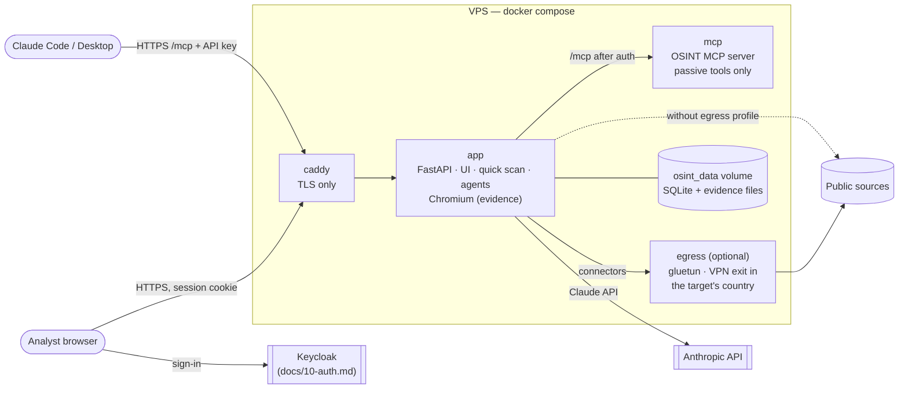

# 9. Deployment & Infrastructure

One VPS, one `docker compose` stack (docs/02-architecture.md). Built to run
the demo and a small team; the "Scaling later" section says what changes when
that stops being enough.



## Services

| Service | Image | Role |
|---|---|---|
| `caddy` | `caddy:2.8.4` | Standalone host only: automatic HTTPS and unbuffered SSE. No authentication (the app does it). |
| `app` | built from `Dockerfile` | FastAPI API, the public landing page at `/` and the analyst app at `/app/`, sign-in (`/auth/*`, Keycloak), workspaces, the authenticated `/mcp` proxy, quick scan, Claude agents. Bundles Chromium (screenshots), Lightpanda (page reading), subfinder, dnstwist, holehe and maigret. Data in the `osint_data` volume (`/data`). |
| `searxng` | `searxng/searxng` | Internal metasearch API for `dork_search` (settings in `searxng/settings.yml`); not reachable from outside. |
| `mcp` | same image | The OSINT MCP server, reached only through the app's `/mcp` (workspace API key), for analysts working from Claude Code. Passive tools only (`MCP_ALLOW_ACTIVE=0`): it has no investigation scope to check. |
| `egress` | `qmcgaw/gluetun` (profile `egress`) | Optional VPN exit. Connector and screenshot traffic goes through it when `OSINT_HTTP_PROXY=http://egress:8888`. Claude API traffic does not. |

Only Caddy publishes ports (80/443). Sign-in, roles and workspaces are the
app's own, against a Keycloak realm: see [docs/10-auth.md](10-auth.md).

## On a Coolify server

Coolify's own proxy owns ports 80/443 and the certificates, so use
`docker-compose.coolify.yml`: the same stack without published ports and
without Caddy. Coolify's proxy sends the domain straight to `app`. Keycloak
is a separate Coolify resource (`deploy/keycloak/`, docs/10-auth.md).

1. Coolify → **New resource** → **Public repository** →
   `https://github.com/dumitreskw/craiova-hackathon`, branch `main`.
2. Build pack **Docker Compose**, compose file `/docker-compose.coolify.yml`.
3. **Domains**: give the `app` service `https://osint.<your-domain>`
   (leave searxng and mcp without domains: they stay internal).
4. **Environment variables**: the keys from `.env.example`, at least
   `OSINT_OIDC_ISSUER`, `OSINT_OIDC_CLIENT_SECRET`, `OSINT_PUBLIC_URL`
   (docs/10-auth.md), `SEARXNG_SECRET`, `ANTHROPIC_API_KEY`. Mark keys as
   secrets.
5. **Deploy.** The first build takes a few minutes (Chromium, tools).

Needs about 4 GB of free RAM on the server alongside what Coolify already
runs, plus about 1 GB for Keycloak and its Postgres.

## One-command deploy

From the repo, with `.env` filled in (domain, sign-in settings,
SEARXNG_SECRET, API keys):

```bash
scripts/deploy.sh root@<server-ip>      # re-run it to update
```

It ships the committed code with `git archive` (no GitHub access needed on
the server), copies `.env`, installs Docker if missing, opens only 22/80/443,
and runs `docker compose up -d --build`. The manual steps below do the same.

## First deploy

Sizing: 2 vCPU / 4 GB RAM / 40 GB disk is enough (Chromium is the largest
consumer). Ubuntu 24.04 with Docker Engine + the compose plugin.

```bash
# DNS: A record osint.example.com -> the VPS IP. Then on the VPS:
sudo ufw allow 22,80,443/tcp && sudo ufw allow 443/udp && sudo ufw enable
git clone https://github.com/dumitreskw/craiova-hackathon.git && cd craiova-hackathon
cp .env.example .env
#   set OSINT_DOMAIN, OSINT_PUBLIC_URL, the OSINT_OIDC_* sign-in settings
#   (docs/10-auth.md), ANTHROPIC_API_KEY and any connector keys
docker compose up -d --build
docker compose logs -f app
```

Open `https://osint.example.com`, sign in, create an investigation.

For a local run of the whole stack, set `OSINT_DOMAIN=localhost` (Caddy uses
its internal CA; accept the certificate warning) and register
`https://localhost` with the bootstrap script's `--app`.

## API keys and quotas

Each connector skips cleanly when its key is missing (`GET /api/v1/connectors`
shows what is available and how much of each monthly quota is used). Metered
sources (Hunter 50/month, Tomba 25/month) are enforced by the ledger across
all investigations; paid ones (DeHashed) never run in the quick scan, only in
agent runs that opt into `costly_connectors: "all"`.

For local development without the tools installed, `OSINT_KALI_SSH=kali` in
`backend/.env` runs subfinder, dnstwist, holehe and maigret on the Kali VM
over ssh, and `OSINT_LIGHTPANDA_CMD` can point at the Lightpanda Docker image.

## Egress from the target's country

Search engines and many local sites return different results depending on
where the request comes from, and the target can log the source IP. The field
practice (CLAUDE.md in the Kali workspace) is to collect from the target's
country and record where the traffic left from. Here:

1. Put WireGuard credentials for your VPN provider in `.env` (`EGRESS_*`) and
   the country in `EGRESS_COUNTRY`.
2. Set `OSINT_HTTP_PROXY=http://egress:8888` and an `OSINT_EGRESS_LABEL`
   (e.g. `mullvad-ro`).
3. `docker compose --profile egress up -d`.

Every finding records the label in its `egress` column. Changing country
means editing `.env` and recreating the `egress` and `app` containers; don't
do it while a scan is running.

## Using the MCP server from Claude Code

Create a workspace API key in *Team and access*, then:

```bash
claude mcp add --transport http osint https://osint.example.com/mcp \
  --header "Authorization: Bearer osk_..."
```

Calls made this way are not recorded in an investigation's ledger. Use them
for quick look-ups; use the app for anything that ends up in a report.

## Operations

| Task | Command |
|---|---|
| Update | `git pull && docker compose up -d --build` |
| Logs | `docker compose logs -f app` |
| Backup (online) | `docker compose exec app python -c "import sqlite3; s=sqlite3.connect('/data/osint.sqlite'); d=sqlite3.connect('/data/backup.sqlite'); s.backup(d)"` then copy `/data/backup.sqlite` and `/data/evidence/` off the box (`docker compose cp app:/data ./backup`) |
| Purge expired investigations | runs at every start; on demand (platform admin): `POST /api/v1/admin/purge-expired` |
| Add an analyst | *Team and access* in the app: invitation link or generated account (docs/10-auth.md) |
| Disable an account | Keycloak admin console, realm `osint`, Users; the app session ends within 5 minutes |
| Rotate a connector key | edit `.env`, `docker compose up -d app mcp` |

Backups contain personal data: encrypt them and give them the same retention
as the investigations they hold.

## Security notes

- **Access**: every API and MCP request is authenticated by the app (session
  cookie, workspace API key or Keycloak token) and scoped to one workspace;
  the audit log's "who" is the signed-in account, never a client header
  (docs/10-auth.md).
- **Secrets** live in `.env` on the host (git-ignored). Nothing secret is
  baked into the image.
- **Containers** run as a non-root user; the app has no Docker socket and no
  host mounts beyond its data volume.
- **Active tooling** (port scans, nuclei, ...) is not in this stack. The Kali
  VM stays a separate, manually operated host (docs/02-architecture.md,
  active-recon module).

## CI

`.github/workflows/ci.yml` runs the backend tests (offline), type-checks and
builds the frontend, and validates the compose file, on every push to `main`
and every pull request.

## Scaling later

- **More users / long agent runs**: move scans and agents out of the API
  process into a worker (e.g. `arq` + Redis) so a deploy doesn't cancel runs.
- **Database**: SQLite in WAL mode is fine for a few analysts; move to Postgres
  when several workers write concurrently.
- **Evidence**: move `/data/evidence` to object storage with server-side
  encryption and lifecycle rules matching the retention policy.
- **Billing**: plans exist (docs/10-auth.md); a payment provider's webhook can
  set `orgs.plan`.
- **Email**: give Keycloak an SMTP server, then turn on email verification and
  password reset.
