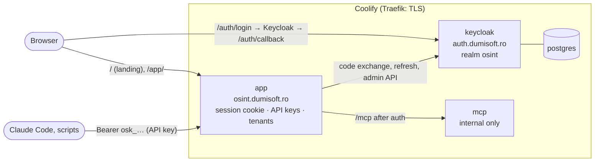

# 10. Accounts, sign-in and workspaces

The platform is multi-tenant: people sign in with a Keycloak account, work
inside **workspaces** (tenants), and only ever see their own workspace's
investigations, audit log, members and API keys.



## Pieces

| | Where | What |
|---|---|---|
| Identity provider | Keycloak 26 (`deploy/keycloak/docker-compose.yml`), its own Coolify resource at `https://auth.dumisoft.ro` | Accounts, passwords, registration, brute-force protection, account console (profile, password, 2FA, sessions). |
| Realm setup | `scripts/keycloak_bootstrap.py` (idempotent) | Realm `osint`, role `platform-admin`, confidential client `osint-web`, the client's service-account rights, an optional operator account. |
| Sign-in | `backend/app/auth/` | OpenID Connect authorization code + PKCE run by the app ("backend for frontend"). Keycloak's tokens stay on the server; the browser holds only an HttpOnly, `SameSite=Lax` session cookie. |
| Tenancy | `users`, `orgs`, `memberships`, `invitations`, `sessions`, `api_keys` tables | Workspaces, roles, invitations, API keys. `investigations.org_id` ties every investigation to one workspace. |

No reverse proxy does authentication any more: Coolify's Traefik terminates TLS
and sends everything to the app, which checks every `/api/*` and `/mcp`
request itself (`app/auth/middleware.py`).

## Who can do what

| Role | Can |
|---|---|
| `viewer` | Read investigations, graphs, reports, the audit log. No writes (enforced for every non-GET request). |
| `analyst` | Everything an investigation needs: targets, scans, agents, reports, material, captures; own API keys. |
| `admin` | Analyst, plus members and roles, invitations, generated accounts, everyone's API keys, renaming the workspace. |
| `owner` | Admin, plus granting or removing `owner`. A workspace always keeps at least one owner. |
| platform admin | Keycloak realm role `platform-admin`: every workspace's plan and suspension (`/api/v1/platform/orgs`), provider credit balances, retention purge, the shared social personas. |

## Account lifecycle

* **Sign-up**: `/auth/register` opens Keycloak's registration (`prompt=create`).
  The first sign-in creates the user row and a workspace of their own on the
  `OSINT_DEFAULT_PLAN` (Free).
* **Invitation**: an admin creates a single-use link (7 days) in *Team and
  access*. Opening it signs the person up or in, then adds them to the workspace
  with the invited role (no personal workspace is created for them).
* **Generated account**: an admin enters email and name; the app creates the
  Keycloak account through the client's service account with a 16-character
  temporary password (shown once) and `UPDATE_PASSWORD` as a required action,
  then adds the member. Their Keycloak id is pre-registered, so the first sign-in
  lands in that workspace.
* **Sessions** last `OSINT_SESSION_DAYS` (14). Every 5 minutes a request
  re-checks the session with Keycloak (refresh grant): a disabled account, a
  reset password or "sign out everywhere" ends it. `/auth/logout` drops the
  session and signs out of Keycloak too.
* **API keys** (`osk_…`, only the sha256 is stored) act in one workspace with
  at most their creator's role, and stop working when the creator leaves the
  workspace. Use them as `Authorization: Bearer osk_…` on the REST API or on
  `/mcp`:

  ```bash
  claude mcp add --transport http osint https://osint.dumisoft.ro/mcp \
    --header "Authorization: Bearer osk_..."
  ```

* A Keycloak **access token** (`Authorization: Bearer <jwt>`, issued to
  `osint-web`) is also accepted; `X-Org: <org id>` picks the workspace.

## Plans

`backend/app/auth/plans.py`: Free (3 seats, 5 open investigations, 2 API keys),
Team (15 / 100 / 20), Enterprise (no limits). Pending invitations count toward
seats. A platform admin changes a workspace's plan in *Platform admin*; billing
can drive the same field later. One user may own at most 5 workspaces.

## Data from before accounts

Investigations created before this change have no workspace. The first time a
platform admin signs in, they move to that admin's workspace (which becomes
Enterprise). Old audit rows keep `org_id` empty and are shown through their
investigation.

## Setting it up

1. Deploy Keycloak: Coolify → new Docker Compose resource with
   `deploy/keycloak/docker-compose.yml`, domain `https://auth.<domain>` on the
   `keycloak` service. Coolify generates the database and master-admin secrets.
2. Provision the realm (re-run any time; it updates in place):

   ```bash
   KC_ADMIN_USER=... KC_ADMIN_PASSWORD=... python scripts/keycloak_bootstrap.py \
     --keycloak https://auth.dumisoft.ro --app https://osint.dumisoft.ro \
     --app http://localhost:8000 --app http://localhost:5173 \
     --operator-email you@example.com
   ```

   The master-admin credentials are the Keycloak service's `SERVICE_USER_ADMIN`
   and `SERVICE_PASSWORD_ADMIN` in Coolify. `--operator-email` creates that
   account (temporary password printed once) and gives it `platform-admin`.
3. On the app: `OSINT_OIDC_ISSUER=https://auth.<domain>/realms/osint`,
   `OSINT_OIDC_CLIENT_SECRET=<printed by the script>`,
   `OSINT_PUBLIC_URL=https://osint.<domain>`; redeploy.

Email: the realm has no SMTP server yet, so email verification and "forgot
password" are off. Configure SMTP in Keycloak (Realm settings → Email), then
turn on `verifyEmail` and `resetPasswordAllowed` in the bootstrap script.

## Local development

Without `OSINT_OIDC_ISSUER`, sign-in is off and every request acts as one local
owner of a "Local workspace" (and the server logs a warning). The compose files
refuse to start without an issuer, so a public host never runs that way. To
test the real flow locally, point `OSINT_OIDC_ISSUER` at the realm (the
bootstrap registers `http://localhost:8000` and `:5173` as redirect URIs) and
set the client secret in `backend/.env`.

## Security notes

* The audit log's "who" is the signed-in account; client headers such as
  `X-Analyst` are ignored.
* Cookie-authenticated writes must come from the platform's own origin
  (`Origin` / `Sec-Fetch-Site` check) on top of `SameSite=Lax`.
* Another workspace's ids return 404, not 403, so ids do not leak.
* The Kali worker API (`/api/v1/worker/*`) keeps its own shared token
  (`OSINT_WORKER_TOKEN`) and is outside user sign-in.
